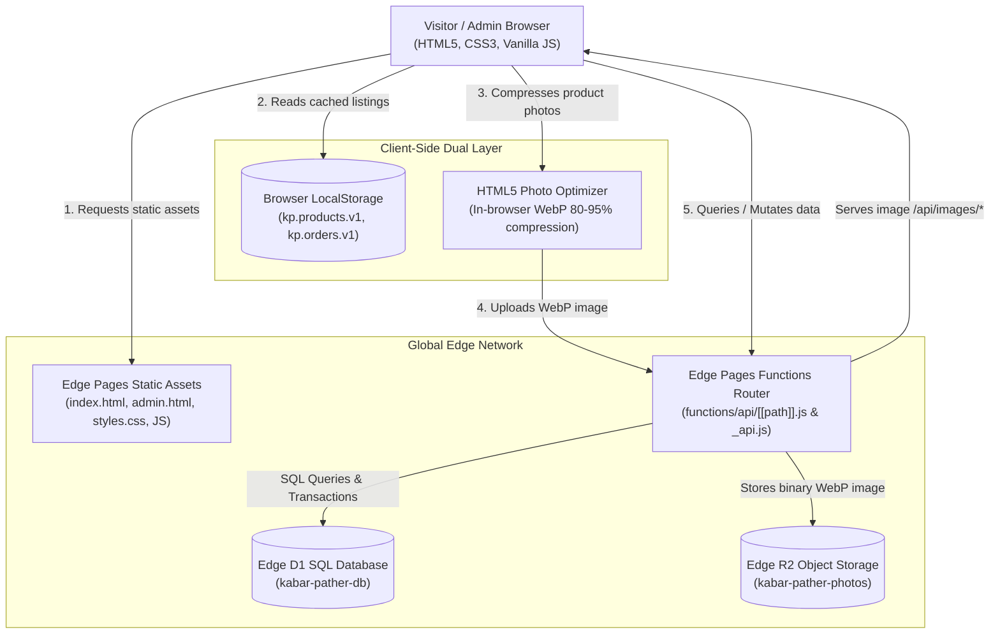
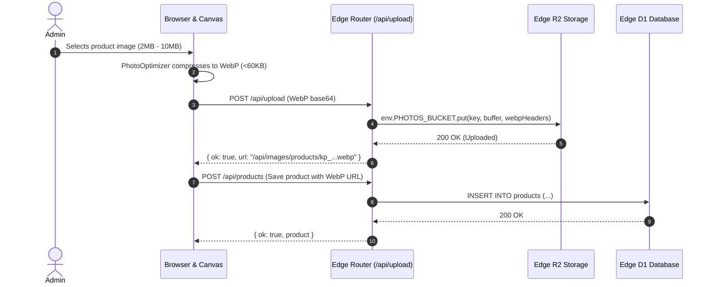
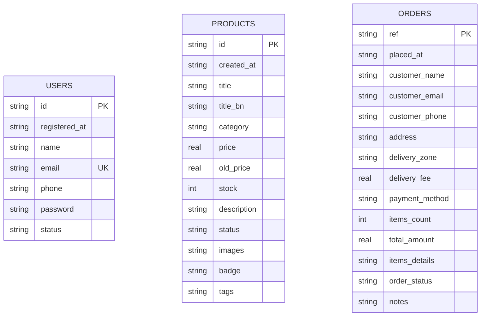

# 🏛️ System Architecture — কবর পথের সামগ্রী (Kabar Pather)

This document outlines the complete architectural design, data flow, component decomposition, and infrastructure topology of **কবর পথের সামগ্রী (Kabar Pather Samogri)**.

---

## 1. High-Level Architecture Topology

কবর পথের সামগ্রী is engineered as an ultra-fast, edge-first, serverless e-commerce platform hosted globally on high-performance edge network infrastructure with zero cold-start latency.



---

## 2. Infrastructure & Edge Components

| Component | Technology | Role & Responsibility |
| :--- | :--- | :--- |
| **Frontend Edge CDN** | Edge Pages Static Assets | Global edge delivery of static HTML (`index.html`, `admin.html`), CSS design tokens, and JavaScript modules. |
| **Serverless API Layer** | Edge Pages Functions | Serverless Edge REST and RPC Action API router located in `functions/api/[[path]].js` and `functions/api/_api.js`. |
| **Relational Database** | Edge D1 SQLite Database | Relational database (`kabar-pather-db`) storing records for `users`, `products`, and `orders` with parameterized prepared queries. |
| **Media Object Storage** | Edge R2 Object Storage | Zero-egress media bucket (`kabar-pather-photos`) storing WebP product photos with public immutable edge cache headers. |
| **Client-Side Cache Layer** | Browser `localStorage` | Instant rendering layer (`kp.products.v1`, `kp.orders.v1`) providing optimistic UI updates, zero perceived latency, and offline resilience. |
| **Photo Compression Engine** | HTML5 Canvas WebP Engine | Client-side compression script (`assets/js/optimization.js`) resizing raw photos and compressing to `.webp` format prior to upload. |

---

## 3. Data Flow & Transaction Lifecycles

### 3.1 Storefront Product Browsing Flow
1. **Initial Asset Request**: Client requests `index.html`. Browser loads design system `styles.css` and scripts from edge CDN.
2. **Instant Cache Check**: `KabarApi.getProducts()` retrieves the local product catalogue immediately from `localStorage` (`kp.products.v1`).
3. **Edge Synchronization**: Concurrently, the client fires a network query `GET /api/products` to the Edge API router.
4. **Edge D1 Query**: The Edge Function executes `SELECT * FROM products ORDER BY rowid DESC`, parses JSON columns (`images`, `tags`), and returns product records.
5. **DOM Reconciliation**: The frontend reconciles remote data with local state and renders the storefront product grid seamlessly.

### 3.2 Product Photo Upload & Optimization Flow (R2 Storage)
1. **Admin Photo Selection**: Admin selects an image (JPEG, PNG, or camera capture) in the sell post form (`admin.html`).
2. **In-Browser WebP Compression**: `PhotoOptimizer.compressImage(file)` loads the image onto an HTML5 Canvas, scales the maximum dimension to 960px, and encodes it into `image/webp` (quality: 0.82). File size is reduced by 80%–95% (typically `< 60 KB`).
3. **Edge R2 Transmission**: The compressed WebP data is transmitted via `POST /api/upload`.
4. **Bucket Storage**: The Edge Function writes the binary buffer into `env.PHOTOS_BUCKET.put('products/kp_...webp', buffer, { httpMetadata })`.
5. **Immutable Edge URL**: The Edge Function returns `/api/images/products/kp_...webp`, which is stored in the product record.



### 3.3 Checkout & Stock Decrement Transaction Flow
1. **Order Submission**: Customer places an order on `index.html` checkout modal via `KabarApi.placeOrder()`.
2. **Edge Batch Transaction**: The Edge Function invokes an atomic batch transaction on `env.DB`:
   - Inserts order record into `orders` table.
   - For every line item in the order, executes:
     ```sql
     UPDATE products SET stock = MAX(0, stock - ?) WHERE id = ?;
     ```
3. **Immediate Confirmation**: Customer receives the confirmed order reference (`KP-XXXXXX`), a direct WhatsApp confirmation link, and catalog stock is decremented immediately across the store.

---

## 4. Database Schema Design (Edge D1 Database)



### Table Specifications:
- **`users`**: Customer accounts and admin profiles. Enforces unique email constraint and indexed access status (`Active` / `Suspended`).
- **`products`**: Product catalogue with technical specifications, English & Bengali titles, pricing, stock levels, and JSON-encoded image URL arrays.
- **`orders`**: Placed orders, customer delivery metadata, delivery zone (`inside_dhaka` / `outside_dhaka`), line item details (JSON array), and fulfillment lifecycle states (`Pending`, `Confirmed`, `Delivered`, `Cancelled`).

---

## 5. Security Architecture

1. **Authentication & Session Isolation**:
   - Fixed Administrator authentication (`admin@kabarpather.com` / `admin123`) verified with session storage flags.
   - Real-time customer access status checks (`Active` / `Suspended`). Suspended accounts are rejected at the edge.
2. **SQL Injection Defense**:
   - 100% of Edge D1 database operations use prepared statements with strict parameter binding (`env.DB.prepare(...).bind(...)`).
3. **CORS Governance**:
   - Standard CORS headers (`Access-Control-Allow-Origin: *`, standard safe methods, pre-flight caching) enabled across all `/api/*` endpoints.
4. **Media Validation**:
   - Upload endpoint strictly accepts and verifies image payloads, converting all uploaded media into `.webp` format before persisting in Edge R2 Storage.
