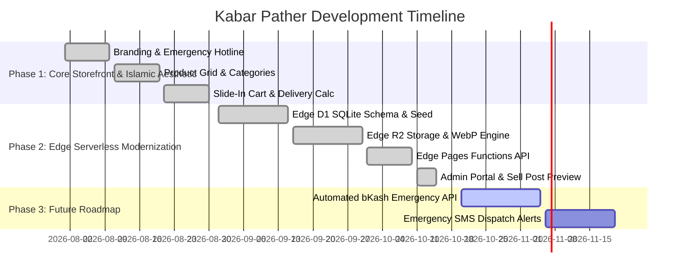

# 📋 Tasks & Roadmap Tracker — কবর পথের সামগ্রী (Kabar Pather)

This document tracks all completed engineering milestones, active development tasks, and the upcoming production roadmap for **কবর পথের সামগ্রী (Kabar Pather Samogri)**.

---

## 1. Milestones Overview

---

## 2. Completed Milestones & Tasks

### ✅ Milestone 1: Storefront UI & Islamic Design System
- [x] Implemented serene Islamic color scheme with Royal Sapphire Blue (`#003885`), gentle accents, and clean spiritual background.
- [x] Integrated **Hind Siliguri** font for natural Bengali typography paired with **Inter** for numerals.
- [x] Added 24/7 emergency dispatch topbar featuring hotline (`01844-687759`), Kamrangirchar address, and WhatsApp link.
- [x] Dynamic category navigation pills (`সকল সামগ্রী`, `কাফনের কাপড়`, `আতর ও সুরমা`, `সম্পূর্ণ প্যাকেজ`, `আনুষঙ্গিক`).
- [x] Real-time live search engine matching Bengali & English product titles, categories, and tags without page reload.
- [x] Dual-theme light and dark mode toggler with persistent browser preference storage.
- [x] Interactive product card with pricing (`৳`), stock badges, and 1-click cart addition.
- [x] Interactive product details modal (`#productModal`) featuring 1-click direct "অর্ডার করুন" (Add to Cart & Checkout drawer) and "WhatsApp এ অর্ডার করুন" buttons.

### ✅ Milestone 2: Shopping Cart & Emergency Checkout Pipeline
- [x] Slide-in cart drawer (`#cartDrawer`) with spring transition, line item listing, and quantity steppers (`+` / `-`).
- [x] Dynamic delivery fee calculator: Dhaka City (`৳৮০`) vs. Outside Dhaka (`৳১৫০`).
- [x] Real-time subtotal and grand total auto-calculation.
- [x] Checkout modal collecting recipient name, 11-digit mobile number (`01XXXXXXXXX`), address, delivery zone, and notes.
- [x] Standardized order reference generation (`KP-XXXXXX`).
- [x] Direct WhatsApp 1-tap confirmation link generating pre-formatted Bengali order messages.
- [x] Customer order tracking modal searching by order reference or mobile number with visual progress timeline.

### ✅ Milestone 3: Full Admin Portal & Sell Post System
- [x] Built standalone administrative portal (`admin.html`, `assets/js/admin.js`).
- [x] Fixed credential security layer (`admin@kabarpather.com` / `admin123`) with session authentication.
- [x] Real-time telemetry cards showing Total Products, Total Orders, Revenue (`৳`), and Total Customers.
- [x] **Sell Post Management**:
  - Full product creation form with English and Bengali titles, category, price, old price, stock, and descriptions.
  - **Live Card Preview**: Real-time rendering of the storefront product card as the administrator types.
- [x] **Manage Products Catalogue**:
  - Search and filter tools.
  - Active/Pause visibility toggle (`🟢 সক্রিয়` / `⏸️ স্থগিত`).
  - In-place product editing and instant deletion.
- [x] **Order Fulfillment Pipeline**:
  - Live order cards with customer details, delivery location, items list, and total amount.
  - One-click customer contact buttons: Direct Call (`tel:`) and Direct WhatsApp chat.
  - Status management dropdown: `Pending`, `Confirmed`, `Delivered`, `Cancelled`.
- [x] **Customer Access Management**:
  - User list displaying registration date, orders count, and 1-click account suspension toggle.

### ✅ Milestone 4: Edge Serverless Platform, D1 Database & R2 Storage
- [x] Configured `wrangler.toml` for Edge Pages, Edge D1 (`kabar-pather-db`), and Edge R2 (`kabar-pather-photos`).
- [x] Created `database/schema.sql` with relational SQLite tables (`users`, `products`, `orders`) and indexes.
- [x] Created `database/seed.sql` populating authentic Islamic burial packages and default admin profile.
- [x] Developed client-side HTML5 Canvas photo optimizer (`assets/js/optimization.js`) compressing images to WebP format (max 960px, quality 0.82) saving 80%–95% file size.
- [x] Built Edge Pages Functions catch-all router (`functions/api/[[path]].js`) and core business logic (`functions/api/_api.js`).
- [x] Built R2 photo upload endpoint (`POST /api/upload`) and streaming edge server (`GET /api/images/*`).
- [x] Unified client API abstraction (`assets/js/api-client.js`) with automatic `localStorage` fallback.
- [x] Verified zero occurrences of prohibited vendor brand words across the repository.

### ✅ Milestone 5: Complete Documentation Suite & Repository Governance
- [x] `README.md`: Comprehensive root repository guide, architecture map, and GitHub badges.
- [x] `docs/PRD.md`: Full Product Requirements Document with personas, functional features, and API contracts.
- [x] `docs/ARCHITECTURE.md`: High-level topology diagram, Edge D1 schema, and WebP compression sequence.
- [x] `docs/DESIGN.md`: Islamic design philosophy, color tokens, typography, and responsive breakpoint matrix.
- [x] `docs/EDGE_DEPLOYMENT.md`: Step-by-step CLI and Git-integrated edge deployment manual.
- [x] `docs/MEMORY.md`: Architectural Decision Records (ADRs including ADR-006), persistent constants, and operational caveats.
- [x] `docs/RULES.md`: Engineering invariants, database rules, WebP rules, and continuous GitHub sync protocol.
- [x] `docs/TASKS.md`: Milestone tracker, completed achievements, and future roadmap.
- [x] `.agents/rules/docs-and-github-sync.md` & `AGENTS.md`: Mandatory continuous documentation maintenance and automatic GitHub synchronization protocol.

---

## 3. Upcoming Roadmap (Milestones 6 & Beyond)

### 📌 Milestone 6: Automated bKash & Nagad Merchant Gateway
- [ ] Connect bKash Direct Checkout API via Edge Pages Functions.
- [ ] Implement instant webhook confirmation to auto-mark emergency orders as `Paid`.

### 📌 Milestone 7: Emergency SMS Dispatch Integration
- [ ] Connect local Bangladeshi SMS gateway (Greenweb / Elitbuzz).
- [ ] Auto-dispatch emergency SMS alerts to delivery riders upon order placement.
- [ ] Send tracking SMS to customer with estimated arrival time.

### 📌 Milestone 8: Mosque Committee & Bulk Donor Portal
- [ ] Bulk donation sponsor program for impoverished deceased individuals (বেওয়ারিশ লাশ দাফন ফান্ড).
- [ ] Mosque bulk restocking discount tier.

---

## 4. Pre-Release Verification Checklist

Every pull request or deployment must verify:
- [x] All 7 files in `docs/` are in sync with the codebase.
- [x] All JavaScript files pass syntax check (`node -c`).
- [x] Zero mentions of prohibited vendor names exist anywhere in the project.
- [x] Photo upload strictly compresses to `.webp` format.
- [x] Database schema is documented and matched with `database/schema.sql`.
